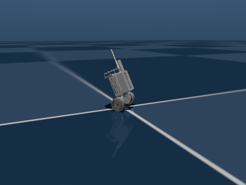

# PPO Balancing Bot RL (`balance_bot_rl`)

Reinforcement learning control for a two-wheel self-balancing robot (`ezspin`) simulated in [MuJoCo](https://mujoco.org) using PPO ([Stable-Baselines3](https://github.com/DLR-RM/stable-baselines3)) and deployed to physical hardware ([ESP32](firmware/README.md) + SimpleFOC).

<div align="center">
  
  <p><em>Trained PPO policy balancing and rejecting external push disturbances in MuJoCo.</em></p>
</div>

---

## Repository Overview

```
ppo_balancing_bot_rl/
├── balance_bot/               # Gymnasium environment & simulation assets
│   ├── env.py                 # BalanceBot-v0 Gymnasium environment
│   └── assets/
│       ├── balance_bot.xml    # MuJoCo MJCF physics definition
│       └── meshes/            # High-fidelity STL robot meshes
├── cad/                       # SolidWorks URDF package (source of truth)
│   └── bot_balancing_urdf/    # URDF, ROS package, launch configs
├── firmware/                  # ESP32 embedded deployment
│   ├── README.md              # Firmware & hardware setup guide
│   └── ezspin_robot_balancing/
│       ├── ezspin_robot_balancing.ino # ESP32 SimpleFOC control loop
│       ├── actor.h            # Pure C neural network policy
│       ├── balancer_pinouts.h # Pin definitions for motors & CAN bus
│       ├── can.h / can.cpp    # CAN bus joystick & telemetry interface
│       ├── imu.h / imu.cpp    # MPU6050 DMP 6-DOF sensor fusion
│       └── src/               # I2Cdev and MPU6050 libraries
├── runs/                      # Model checkpoints and logs
│   └── ppo_full/              # Pretrained reference model (best & final)
├── web/                       # Three.js browser viewer
│   └── index.html             # Client-side 3D rendering interface
├── train.py                   # PPO training pipeline (SB3)
├── play.py                    # Policy viewer in MuJoCo
├── play_parallel.py           # Multi-robot parallel viewer
├── test_policy.py             # Evaluation & disturbance rejection benchmark
├── record_video.py            # Record animated GIF & MP4 demo clips
├── web_viewer.py              # Zero-install browser 3D streaming server
├── export_onnx.py             # Export SB3 policy to ONNX and C header
├── onnx_to_c.py               # Pure-C network compiler for microcontrollers
├── pyproject.toml             # Python package configuration
└── requirements.txt           # Python dependencies
```

---

## Quick Start

### 1. Installation

```bash
# Clone the repository
git clone https://github.com/sok-serey/PPO_ezspin_bot_RL.git
cd PPO_ezspin_bot_RL

# Create and activate a virtual environment
python -m venv .venv
# Linux / macOS:
source .venv/bin/activate
# Windows PowerShell:
.venv\Scripts\Activate.ps1

# Install package and dependencies
pip install -r requirements.txt
pip install -e .
```

### 2. View Pretrained Model Immediately

The repository includes a verified pretrained policy in `runs/ppo_full/best_model.zip`:

```bash
# Single robot interactive viewer:
python play.py runs/ppo_full/best_model.zip

# 8 parallel robots visualizer:
python play_parallel.py runs/ppo_full/best_model.zip

# Headless benchmark & disturbance rejection test:
python test_policy.py --no-render --push
```

*(Note for macOS: use `mjpython play.py ...` to run the viewer)*

---

## Training

Train a new PPO policy across vectorized parallel environments:

```bash
# Standard training (2M timesteps, 8 parallel environments)
python train.py

# Quick test run (~3-5 minutes on CPU)
python train.py --timesteps 300000

# Train with forward speed tracking (command_vel)
python train.py --command-vel

# Monitor real-time training progress with TensorBoard
tensorboard --logdir runs
```

---

## Sim-to-Real Hardware Deployment

The trained policy is designed for zero-shot sim-to-real transfer:

1. **Export PyTorch Policy to ONNX and pure C Header:**
   ```bash
   python export_onnx.py runs/ppo_full/best_model.zip
   ```
2. **Compile directly into ESP32 Firmware:**
   ```bash
   python onnx_to_c.py runs/ppo_full/best_model.onnx firmware/ezspin_robot_balancing/actor.h
   ```
3. **Flash ESP32:**
   Open `firmware/ezspin_robot_balancing/ezspin_robot_balancing.ino` in Arduino IDE and flash to your board. See [firmware/README.md](firmware/README.md) for full pinouts and tuning instructions.

---

## Remote 3D Web Viewer

Stream simulation poses to any phone, tablet, or browser over local network:

```bash
python web_viewer.py --port 8080
# Open http://localhost:8080 in your browser
```

---

## Record Demo Video & GIF for GitHub

Generate animated GIF or MP4 videos of your robot balancing and recovering from pushes:

```bash
# Record 6-second balancing GIF from newest trained model:
python record_video.py

# Record specific model to MP4 and GIF with custom duration:
python record_video.py runs/ppo_full/best_model.zip --duration 6 --output docs/assets/balance_bot.gif
```

---

## Physics & Environment Specifications

| Parameter | Specification |
|---|---|
| **Control Frequency** | 100 Hz (sim 500 Hz, frame skip 5) |
| **Action Space** | Continuous (2): normalized left/right wheel torques in `[-1.0, 1.0]` (±0.3 N·m) |
| **Observation Space** | 4-DOF: `[pitch, pitch_rate, left_wheel_vel * 0.1, right_wheel_vel * 0.1]` (+1 with `--command-vel`) |
| **Reward Function** | Upright bonus − pitch error − pitch rate − velocity tracking error − yaw rate − control effort − action jitter; −10 on fall |
| **Domain Randomization** | Mass (±20%), ground friction (±40%), COM offset (±6 mm), joint damping & stiction, motor asymmetry (±15%), deadband, latency lag, IMU bias & Gaussian noise, random impulse pushes |

---

## License

This project is licensed under the MIT License.
